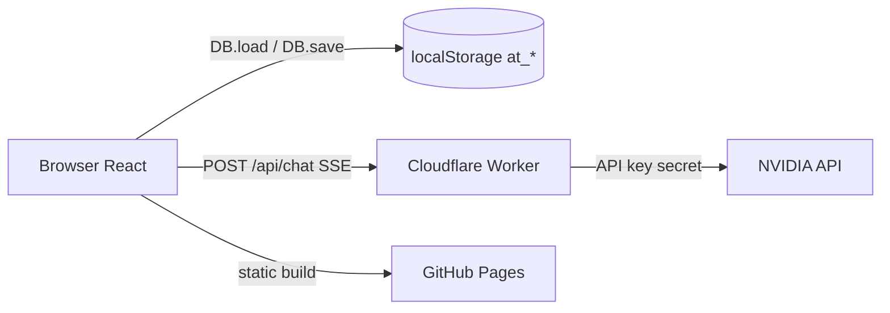

# Tech Stack

## Frontend

| Teknologi | Versi | Fungsi |
| :--- | :--- | :--- |
| React | 19.x | UI |
| React DOM | 19.x | Render browser |
| Vite | 8.x | Dev server & build |
| Tailwind CSS | 4.x | Styling utility-first |
| `@tailwindcss/vite` | 4.x | Plugin Tailwind untuk Vite |
| lucide-react | 1.x | Ikon |
| chart.js | 4.x | Grafik dashboard |
| leaflet | 1.9.x | Peta pemilihan titik jemput |

## Tooling

| Tool | Fungsi |
| :--- | :--- |
| Oxlint | Lint |
| Wrangler | Cloudflare Worker (AI proxy) |
| GitHub Actions | Build & deploy GitHub Pages |
| Google Apps Script | Backend Google Sheets mode direct (kode 1.3.0, storage kolom; deployment masih skema JSON lama) |

## Yang **tidak** dipakai

- **React Router** — navigasi memakai state `view` di `AppContext`.
- **Redux/Zustand** — state global memakai React Context.
- **TypeScript** — seluruh kode aplikasi `.js`/`.jsx`.
- **Backend API aplikasi** — mode default masih `localStorage`; adapter Google Apps Script sudah ada, tetapi Web App ter-deploy belum mendukung `sync`. Worker yang berjalan hanya untuk AI.
- **Framework test** — belum ada unit/integration test; validasi lewat lint dan manual.

## Arsitektur singkat

## Konsekuensi teknis

- State tidak reaktif otomatis saat `localStorage` berubah; aplikasi memakai `tick`/`refresh`.
- Tidak ada URL per halaman; refresh browser kembali ke `initialView`.
- Data antar tab disinkronkan lewat event `storage`, bukan server.
- Semua logika bisnis berjalan di client, sehingga mudah dipelajari tetapi tidak aman untuk produksi.
- AI tetap aman karena API key hanya di Worker.

## Rencana Google Sheets

Backend Google Sheets sudah mencapai `code.gs` 1.3.0 dengan `sync` ter-scope, skema penyimpanan kolom (schema 2), dan 286 asersi lokal. Adapter frontend (cache, diff, rollback, bootstrap) juga sudah ada, tetapi spreadsheet produksi masih format JSON lama (harus reset + seed ulang) dan probe CORS browser belum dilakukan; mode default tetap `local`. Lihat [[Database Google Sheets]].

## Sumber

- `transaceh-react/package.json`
- `transaceh-react/vite.config.js`
- `transaceh-react/worker/wrangler.toml`
- `google-apps-script/seed.gs`
- `google-apps-script/code.gs`
- `docs/AI_SETUP.md`

Lihat juga [[Build dan Deploy]] dan [[Technical Debt dan Jebakan]].
