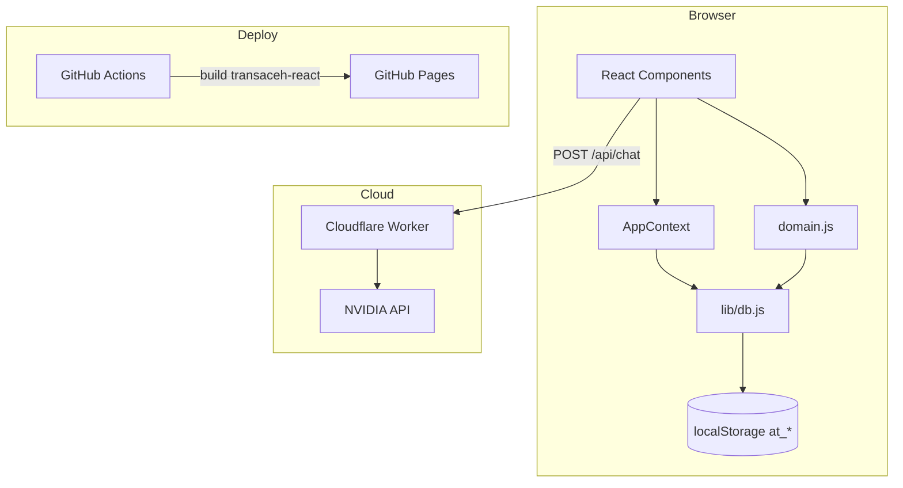

# Arsitektur — MOC

Aplikasi adalah SPA React dengan data default di `localStorage` dan satu Worker untuk AI. Backend Google Sheets 1.3.0 (storage kolom v2) serta adapter frontend sudah ada, tetapi spreadsheet produksi masih format JSON lama dan mode Sheets belum diaktifkan sampai reset+seed ulang/deploy/CORS/uji per peran/lifecycle server-side lulus.

## Catatan

- [[Bootstrap dan Provider]] — urutan start aplikasi dan efek samping awal.
- [[Navigasi dan View Router]] — cara `view` menggantikan React Router.
- [[State Management]] — state global, `tick`, modal, toast, checkout draft.
- [[Lapisan Data dan Seed]] — `DB.load/save`, seed, migrasi.
- [[Database Google Sheets]] — seed produksi, skema tab, dan rencana migrasi.
- [[Lapisan Domain]] — aturan bisnis di `domain.js`.
- [[UI dan Desain]] — Tailwind, komponen UI, ikon, peta, chart.
- [[Pusat Bantuan dan AI]] — chatbot, Worker, privasi.
- [[Build dan Deploy]] — Vite, GitHub Pages, Wrangler.

## Prinsip besar

1. **Client-only (masih)** — belum ada API aplikasi; semua data aktif di browser. Google Sheets baru tahap seed.
2. **State global minimal** — Context menyimpan navigasi dan UI, bukan seluruh data.
3. **Data dibaca langsung** — komponen memanggil `DB.load()` saat render.
4. **Refresh manual** — `refresh()` menaikkan `tick` agar render ulang.
5. **Domain terpusat** — aturan bisnis sedapat mungkin di `lib/domain.js`.

Lihat [[Technical Debt dan Jebakan]] untuk konsekuensi desain ini.
