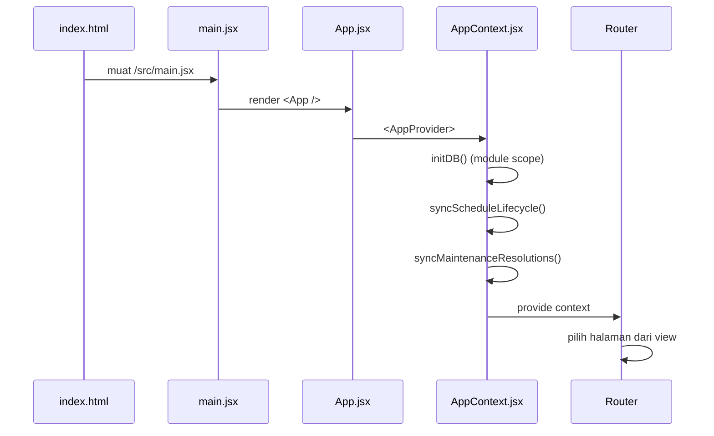

# Bootstrap dan Provider

## Urutan start

## Langkah detail

1. `transaceh-react/index.html` memuat `/src/main.jsx`.
2. `main.jsx` merender `<App />` di dalam `StrictMode`.
3. `App.jsx` membungkus `Router` dengan `AppProvider`.
4. Di module scope `AppContext.jsx`:
   - `initDB()` — seed dan migrasi `localStorage`.
   - `syncScheduleLifecycle()` — menutup jadwal yang sudah lewat (melewati maintenance).
   - `syncMaintenanceResolutions()` — menyelesaikan periode maintenance dan refund otomatis.
5. `AppProvider` membuat state global dan mengembalikan `AppCtx.Provider`.
6. `Router` memilih komponen berdasarkan `view`.

> [!info] Module scope, bukan `useEffect`
> `initDB()`, `syncScheduleLifecycle()`, dan `syncMaintenanceResolutions()` dijalankan saat modul diimpor, sebelum render pertama. Ini membuat data siap sebelum komponen membaca `localStorage`.

## Efek samping di provider

| Efek | Interval | Fungsi |
| :--- | :--- | :--- |
| `cleanupHolds()` | 10 detik | Batalkan booking pending yang hold-nya habis |
| `syncScheduleLifecycle()` | 60 detik | Tutup jadwal lewat waktu, tandai `missed`/`ontrip` |
| `syncMaintenanceResolutions()` | 60 detik | Selesaikan maintenance, refund otomatis, tutup jadwal lampau |
| `storage` event | saat tab lain berubah | Menaikkan `tick` agar UI ikut segar |
| `keydown` Escape | event | Menutup modal |
| `body.overflow` | saat modal berubah | Mencegah scroll latar |

## State awal

- `initialView()` membaca `currentUser()` dan `agencyPending()`.
- Non-pelanggan diarahkan ke `roleHome(role)`.
- `currentUser()` membaca `at_session` lalu mencari user di `at_users`.
- Jika akun diblokir, session dihapus dan user dianggap `null`.

## Sumber

- `transaceh-react/src/main.jsx:1-10`
- `transaceh-react/src/App.jsx:100-106`
- `transaceh-react/src/store/AppContext.jsx:8-30` — init, sync, dan initial view.
- `transaceh-react/src/store/AppContext.jsx:32-140` — state dan efek (termasuk maintenance).
- `transaceh-react/src/lib/domain.js:61-72` — `currentUser`, `setSession`.

Lihat [[State Management]] dan [[Navigasi dan View Router]].
