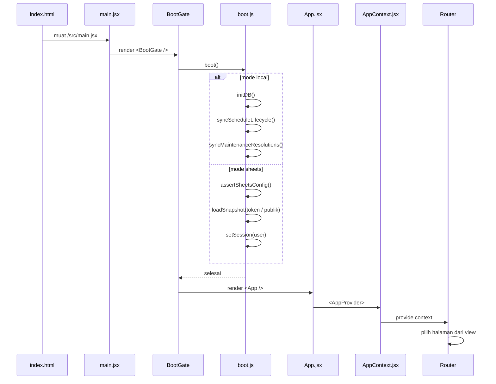

# Bootstrap dan Provider

## Urutan start

## Langkah detail

1. `transaceh-react/index.html` memuat `/src/main.jsx`.
2. `main.jsx` merender `BootGate` di dalam `StrictMode`.
3. `BootGate` memanggil `boot()` sekali lewat `useEffect`; UI menampilkan loading sampai selesai atau error.
4. `boot.js` memilih jalur:
   - **local**: `initDB()`, `syncScheduleLifecycle()`, lalu `syncMaintenanceResolutions()`.
   - **sheets**: `assertSheetsConfig()`, coba token tersimpan, lalu `loadSnapshot(token)`; token tidak valid dibersihkan dan snapshot publik dimuat. `setSession()` dipanggil setelah snapshot berhasil.
5. Setelah boot selesai, `App.jsx` merender `AppProvider`.
6. `AppContext` menentukan `initialView`, memasang handler error sync, dan (khusus local) interval lifecycle.
7. `Router` memilih komponen berdasarkan `view`.

> [!info] Boot sebelum render
> Bootstrap berjalan di `BootGate`, bukan module scope. Komponen baru membaca cache setelah snapshot lokal/Sheets siap.

> [!warning] Lifecycle hanya local
> `cleanupHolds()`, `syncScheduleLifecycle()`, dan `syncMaintenanceResolutions()` hanya berjalan di mode `local`. Di mode Sheets, ketiganya dimatikan karena memutasi data lintas pemilik dan akan ditolak `sync`. Belum ada trigger server-side; lihat [[Database Google Sheets]].

## Efek samping di provider

| Efek | Interval | Fungsi | Mode |
| :--- | :--- | :--- | :--- |
| `cleanupHolds()` | 10 detik | Batalkan booking pending yang hold-nya habis | local |
| `syncScheduleLifecycle()` | 60 detik | Tutup jadwal lewat waktu, tandai `missed`/`ontrip` | local |
| `syncMaintenanceResolutions()` | 60 detik | Selesaikan maintenance, refund otomatis, tutup jadwal lampau | local |
| `storage` event | saat tab lain berubah | Menaikkan `tick` agar UI ikut segar | local |
| `keydown` Escape | event | Menutup modal | semua |
| `body.overflow` | saat modal berubah | Mencegah scroll latar | semua |

## State awal

- `initialView()` membaca `currentUser()` dan `agencyPending()`.
- Non-pelanggan diarahkan ke `roleHome(role)`.
- `currentUser()` membaca `at_session` lalu mencari user di `at_users`.
- Jika akun diblokir, session dihapus dan user dianggap `null`.

## Sumber

- `transaceh-react/src/main.jsx:1-48` — `BootGate` dan render akar.
- `transaceh-react/src/lib/boot.js:1-47` — jalur boot local/Sheets.
- `transaceh-react/src/lib/runtime.js:1-15` — mode data dan validasi URL.
- `transaceh-react/src/App.jsx:1-40` — `AppProvider` dan Router.
- `transaceh-react/src/store/AppContext.jsx:8-30` — import, initial view.
- `transaceh-react/src/store/AppContext.jsx:88-157` — handler sync, logout, interval lifecycle.
- `transaceh-react/src/lib/domain.js:61-72` — `currentUser`, `setSession`.

Lihat [[State Management]] dan [[Navigasi dan View Router]].
