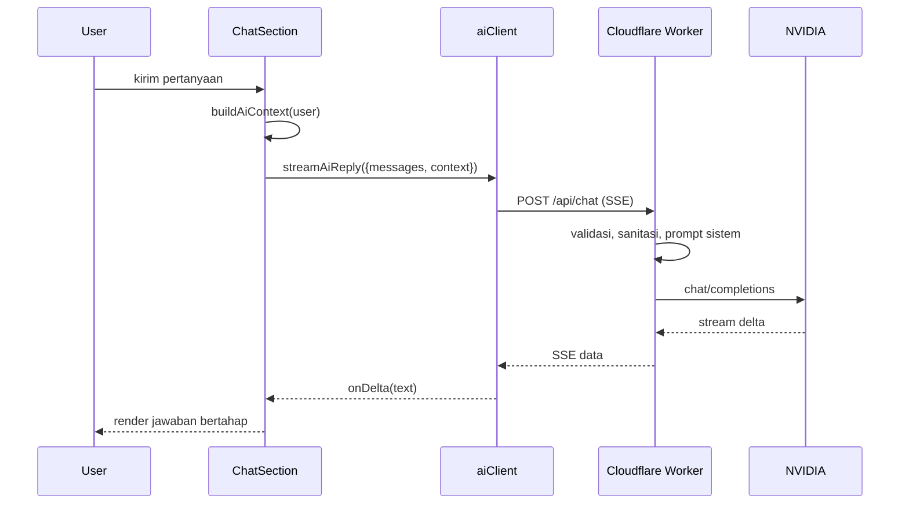

# Pusat Bantuan dan AI

## Dua lapisan bantuan

1. **Support ticket lokal** — laporan/chat disimpan di `at_supportTickets`, dikelola admin.
2. **Asisten AI** — chatbot streaming via Cloudflare Worker dan NVIDIA.

## Arsitektur AI



## File

| File | Fungsi |
| :--- | :--- |
| `src/pages/help/ChatSection.jsx` | UI chat, streaming, stop, retry, fallback FAQ |
| `src/lib/aiClient.js` | Klien SSE, timeout 90 detik, error code |
| `src/lib/aiContext.js` | Ringkasan maksimal 5 booking + 5 tiket milik user |
| `src/lib/aiPrompt.js` | Prompt sistem, aturan, FAQ, data pengguna |
| `src/lib/aiPrivacy.js` | Redaksi PII |
| `worker/src/index.js` | Validasi request, CORS, prompt, proxy NVIDIA |
| `docs/AI_SETUP.md` | Setup lokal, deploy, CORS, rotasi key |

## Batasan dan keamanan

- Browser **tidak pernah** memegang API key NVIDIA.
- Worker membatasi ukuran body, jumlah pesan, dan panjang konteks.
- Hanya data milik user login yang diringkas; tidak ada nama/HP penumpang.
- `redactPII()` menyaring email/telepon dari subjek dan pesan tiket.
- CORS dibatasi `ALLOWED_ORIGINS`.
- Jika `VITE_AI_PROXY_URL` kosong, chat memakai FAQ lokal.
- Streaming memakai SSE; `reasoning_content` diabaikan.

## Environment

```dotenv
VITE_AI_PROXY_URL=http://localhost:8787
```

Worker secret:

```text
NVIDIA_API_KEY=nvapi-...
```

## Sumber

- `transaceh-react/src/lib/aiClient.js:28-127`
- `transaceh-react/src/lib/aiContext.js:10-51`
- `transaceh-react/src/lib/aiPrompt.js:139`
- `transaceh-react/src/lib/aiPrivacy.js:6`
- `transaceh-react/worker/src/index.js:1-120`
- `docs/AI_SETUP.md`

Lihat [[Alur Support dan Chat AI]] dan [[Build dan Deploy]].
