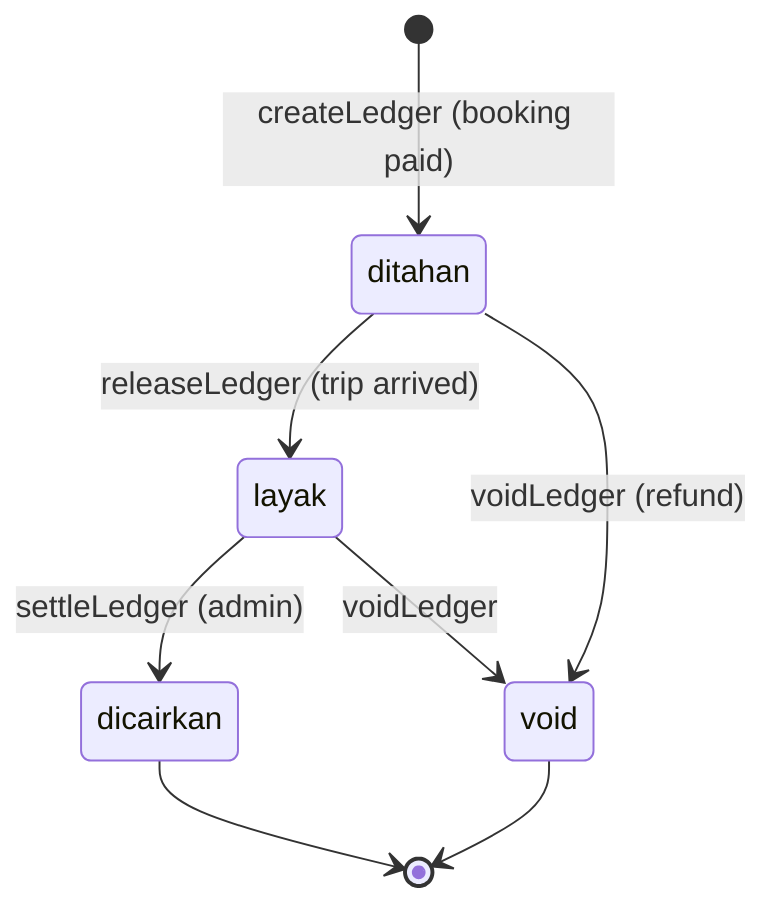

# Data — `payments` dan `ledger`

## `payments`

Satu booking memiliki satu payment pada alur normal.

| Field | Tipe | Keterangan |
| :--- | :--- | :--- |
| `id` | string | `PAY...` |
| `bookingId` | string | Relasi ke booking |
| `amount` | number | Nominal |
| `method` | string | `QRIS`, `VA`, `E-Wallet`, `Transfer` |
| `status` | string | `pending`, `paid`, `cancelled`, `refunded` |
| `time` | ISO string | Waktu dibuat |
| `fee` | number | Fee platform saat pembayaran |

### Field refund

`refundAmount`, `refundPct`, `refundScope`, `refundStatus`, `refundRequestedAt`, `refundedAt`, `refundPaidAt`, `refundProcessedAt`.

### Sinkronisasi status

- Checkout → payment `pending`.
- Pembayaran berhasil → payment `paid`, booking `paid`.
- Booking pending dibatalkan → payment `cancelled`.
- Refund selesai → payment `refunded`.
- `updatePaymentRefund()` menyelaraskan data refund booking ke payment.

## `ledger`

Ledger adalah catatan pembagian uang per booking.

| Field | Tipe | Keterangan |
| :--- | :--- | :--- |
| `id` | string | `LG...` |
| `bookingId` | string | Satu ledger per booking |
| `scheduleId` | string | Untuk rilis massal saat trip tiba |
| `agencyId` | string | Agen penerima jasa |
| `driverId` | string/null | Pengemudi penerima tiket |
| `userEmail` | string/null | Pelanggan |
| `seats` | array | Kursi |
| `ticket` | number | Bagian pengemudi |
| `service` | number | Bagian agen |
| `fee` | number | Bagian platform |
| `total` | number | Total |
| `status` | string | `ditahan`, `layak`, `dicairkan`, `void` |
| `createdAt` | ISO string | Dibuat saat booking paid |
| `releasedAt` | ISO string/null | Saat trip arrived |
| `paidOutAt` | ISO string/null | Saat admin mencairkan |

### Siklus

### Aturan

- `createLedger()` hanya membuat ledger jika booking `paid` dan belum punya ledger.
- `releaseLedger(scheduleId)` merilis semua ledger `ditahan` pada jadwal yang tiba.
- `voidLedger(bookingId)` membatalkan ledger yang belum dicairkan.
- `settleLedger(ids)` hanya mencairkan yang berstatus `layak`.
- `ledgerEligible(e)` mensyaratkan sudah 24 jam sejak `arrivedAt`/`releasedAt`.
- Ledger yang sudah `dicairkan` tidak bisa di-void; refund harus manual.
- Driver wallet menjumlahkan `ticket`; agen melihat `service`; admin melihat `fee`.

> [!warning] Ledger bukan saldo
> Tidak ada tabel saldo. Saldo dihitung dari agregasi ledger setiap kali halaman dibuka.

## Sumber

- `transaceh-react/src/pages/Search.jsx:275-277` — payment awal.
- `transaceh-react/src/lib/domain.js:1185-1207` — create/release/void.
- `transaceh-react/src/lib/domain.js:1224-1237` — update refund payment.
- `transaceh-react/src/lib/domain.js:1813-1827` — settle dan eligibility.
- `transaceh-react/src/admin/Settlement.jsx:8-120` — UI settlement.

Lihat [[Alur Ledger dan Settlement]] dan [[Alur Pembatalan dan Refund]].
