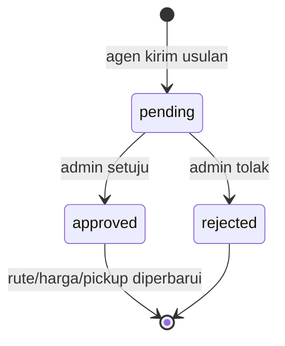

# Data — `routes` dan `routeRequests`

## `routes`

| Field | Tipe | Keterangan |
| :--- | :--- | :--- |
| `id` | string | `R...` |
| `from`, `to` | string | Kota asal/tujuan |
| `distance`, `duration` | string | Estimasi, mis. `±120 km`, `3j 30m` |
| `basePrice` | number | Harga dasar |
| `prices` | object | Harga per agen: `{ [agencyId]: number }` |
| `homePickup` | boolean | Mengizinkan jemput rumah |
| `pickups` | array | Titik jemput, termasuk terminal |
| `vehicleIds` | array | Armada yang terhubung |
| `active` | boolean | Rute bisa dipesan |
| `agencyId` | string | Agen pembuat |
| `agencyIds` | array | Agen yang berhak menjual |
| `driverId`, `driverIds` | string/array | Pengemudi terkait (opsional) |
| `suspensions` | object | `{ [agencyId]: { reason, at } }` |

### Aturan harga

- `priceForAgency(route, agencyId)` memakai `prices[agencyId]`; fallback `basePrice`.
- Satu rute bisa punya harga berbeda per agen.
- `vehicleIds` harus milik agen yang sesuai; validasi dilakukan saat request dan jadwal.

### Suspend

- Suspend bersifat **per agen-rute**, bukan mematikan rute global.
- `isRouteSuspended(route, agencyId)` mengecek `suspensions[agencyId]`.
- `routeBookable(route)` benar jika masih ada agen yang tidak disuspend.
- Admin mengirim notifikasi ke semua akun agen terkait.

## `routeRequests`

| Field | Tipe | Keterangan |
| :--- | :--- | :--- |
| `id` | string | `RQ...` |
| `agencyId` | string | Agen pengusul |
| `type` | string | `rute-baru`, `ubah-harga`, `titik-jemput` |
| `routeId` | string/null | Untuk ubah harga/titik jemput |
| `from`, `to` | string | Kota |
| `pickup`, `pickups` | string/array | Titik jemput usulan |
| `note` | string | Catatan agen |
| `price` | number | Harga usulan |
| `homePickup` | boolean | Usul jemput rumah |
| `distance`, `duration` | string | Estimasi |
| `vehicleIds` | array | Armada valid milik agen |
| `status` | string | `pending`, `approved`, `rejected` |
| `adminNote` | string | Alasan/keputusan admin |
| `createdAt`, `decidedAt` | ISO string | Waktu |

### Alur keputusan

Saat `rute-baru` disetujui:

- Dibuat objek `routes` baru.
- `agencyIds = [agencyId]`.
- `prices = { [agencyId]: price }` jika harga > 0.
- `pickups` diisi `Terminal <from>` + titik usulan; jika kosong, `Terminal <from>` dan `Terminal <to>`.
- `distance`/`duration` memakai input atau estimasi `estimateRoute`.
- `vehicleIds` hanya armada aktif milik agen.

Saat `ubah-harga` disetujui: `prices[agencyId]` diperbarui.
Saat `titik-jemput` disetujui: titik baru ditambahkan tanpa duplikat.

## Sumber

- `transaceh-react/src/lib/domain.js:1830-1916` — normalisasi, suspend, request, keputusan.
- `transaceh-react/src/agen/Routes.jsx:10-130` — form usulan.
- `transaceh-react/src/admin/Routes.jsx:10-130` — panel admin.

Lihat [[Alur Pengajuan Rute]] dan [[Data - vehicles dan drivers]].
