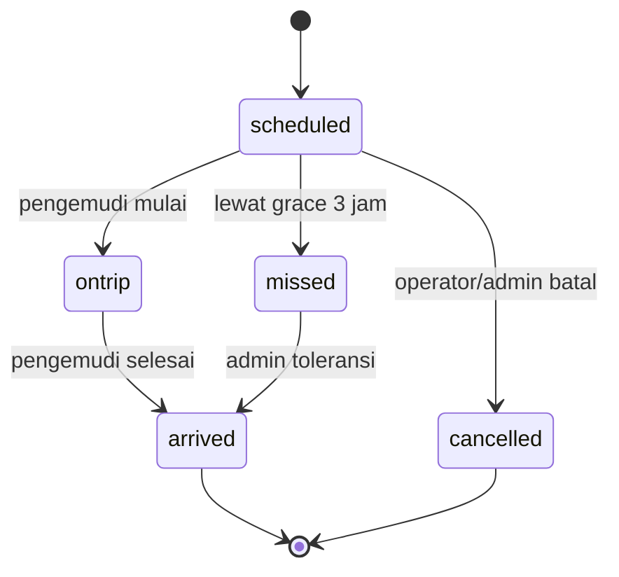
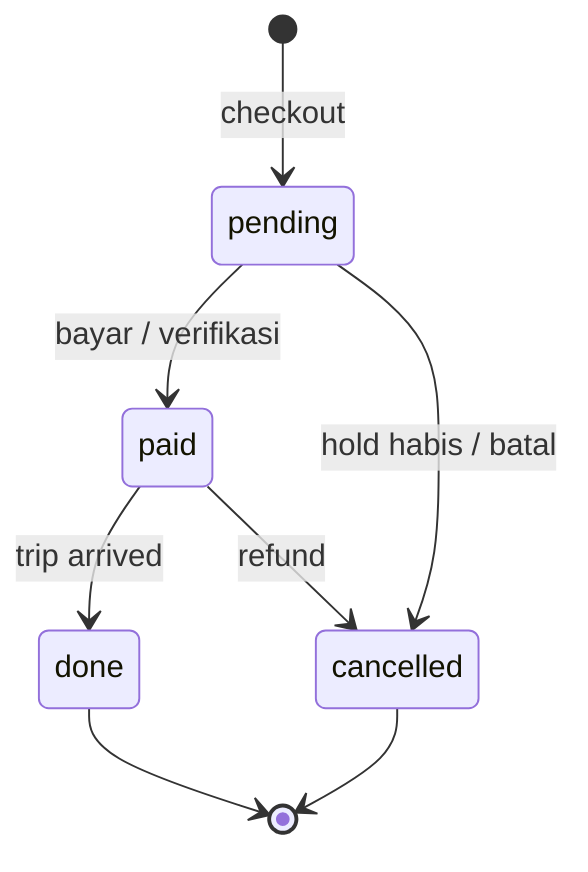

# Data — `schedules` dan `bookings`

## `schedules`

Satu jadwal = satu keberangkatan untuk satu rute, armada, dan pengemudi.

| Field | Tipe | Keterangan |
| :--- | :--- | :--- |
| `id` | string | `S-...` |
| `agencyId` | string | Agen penyelenggara |
| `routeId` | string | Rute |
| `date` | `YYYY-MM-DD` | Tanggal |
| `time` | `HH:MM` | Jam |
| `vehicleId` | string | Armada |
| `driverId`, `driverName` | string | Pengemudi utama |
| `backupDriverId`, `backupName` | string/null | Pengemudi cadangan |
| `price` | number | Harga all-in per kursi |
| `status` | string | `open`, `closed`, `cancelled` |
| `tripStatus` | string | `scheduled`, `ontrip`, `arrived`, `missed`, `cancelled` |
| `blockedSeats` | array | Kursi yang diblokir manual |
| `seatBlockLog` | array | Riwayat blokir, maksimal 30 |
| `createdAt` | ISO string | Waktu dibuat |

### Field delay

`delayUntil`, `delayMinutes`, `delayAddedMinutes`, `delayReason`, `delayNote`, `delayedAt`, `delayedBy`, `delayHistory` (maksimal 20).

### Field perjalanan

`departedAt`, `departedBy`, `earlyStartReason`, `arrivedAt`, `lateCompletion`, `tripDelayInfo`.

### Field pembatalan/review

`cancelReason`, `cancelledBy`, `cancelledAt`, `reviewedAt`, `reviewResult`, `refundPct` (untuk no-show).

### Field maintenance

`maintenanceRequestId`, `maintenanceFrom`, `maintenanceUntil`, `maintenanceStatus` (`active`/`done`), `maintenanceReason`, `maintenanceUpdatedAt`.

Jadwal yang terkena maintenance tetap `status = 'open'` dan `tripStatus = 'scheduled'` selama periode berjalan, tetapi tidak bisa dijual. `scheduleMaintenance()` membaca request yang disetujui atau status armada legacy. Setelah periode lewat, `syncMaintenanceResolutions()` menandai request `selesai`; jadwal lampau yang belum berangkat ditutup dan `tripStatus = 'cancelled'`.

### Status jadwal

`status` dan `tripStatus` berbeda:

- `status` mengatur apakah jadwal masih bisa dijual (`open`/`closed`).
- `tripStatus` mengatur posisi perjalanan.

## `bookings`

| Field | Tipe | Keterangan |
| :--- | :--- | :--- |
| `id` | string | `BK...` |
| `code` | string | Kode tiket `TA-XXXXX` |
| `scheduleId` | string | Jadwal |
| `userEmail` | string/null | `null` untuk booking yang dibuat pengemudi |
| `userPhone` | string/null | Opsional |
| `passengers` | array | `{ name, phone, seat, pickup, pickupCoords }` |
| `pickupCoords` | string | Koordinat jemput rumah |
| `seats` | array | Kursi yang dipesan |
| `subtotal` | number | Harga sebelum diskon |
| `discount` | number | Diskon voucher |
| `total` | number | Total bayar |
| `status` | string | `pending`, `paid`, `done`, `cancelled` |
| `payMethod` | string | Metode simulasi |
| `voucher` | string | Kode voucher |
| `createdAt`, `paidAt`, `holdExpiry` | ISO string | Waktu |
| `tripStatus` | string | Status perjalanan booking |
| `boarded` | boolean | Sudah boarding |
| `source` | string | `driver` untuk booking dari pengemudi |
| `createdBy` | string/null | Driver ID |
| `fare` | object | Snapshot `{ ticket, service, fee, total }` |
| `rating` | number | Rating setelah perjalanan |
| `refund...` | campuran | Lihat di bawah |

### Field refund

`refundPct`, `refundAmount`, `refundScope` (`ticket`), `refundStatus` (`none`, `pending`, `diproses`, `done`), `refundPaidAt`, `refundProcessedAt`, `refundProcessedBy`, `cancelReason`, `cancelledBy`, `cancelledAt`.

### Field maintenance booking

- `maintenanceRequestId`, `maintenanceOriginalScheduleId`, `maintenanceFrom`, `maintenanceUntil`.
- `maintenanceState`: `choice_pending`, `replaced`, `refunded`, atau `cancelled_unpaid`.
- `maintenanceRefundAmount` — 100% dari `total` saat approval.
- `maintenanceChoiceDeadline` — batas refund/pindah; dihitung dari keberangkatan efektif.
- `maintenanceResolvedAt`.
- `replacementScheduleId`, `replacementAt`, `replacementBy`.

Booking `pending` yang terkena maintenance langsung `cancelled` tanpa refund. Booking `paid` mendapat `choice_pending` bila ada pengganti valid dan akun pelanggan; jika tidak, refund 100% otomatis. Booking yang sudah `replaced` tetap dihitung pada maintenance berikutnya dan boleh diproses lagi.

### Status booking

## Aturan penting

- `holdExpiry` default 15 menit; `cleanupHolds()` membatalkan yang lewat.
- `takenSeats()` menghitung `paid` + `pending` (hold) + `blocked` + `inactive`.
- `seatsLeft()` = kapasitas layout − kursi terpakai.
- `fare` dibuat saat pembayaran sukses; untuk booking lama, `splitFare()` dipakai sebagai fallback.
- Booking `pending` yang jadwalnya berangkat otomatis dibatalkan oleh `setScheduleTripStatus()`.
- Booking `paid` menjadi `done` saat jadwal `arrived`.
- Booking driver memakai `source: 'driver'`; jasa agen = 0 pada `splitFare`.

## Sumber

- `transaceh-react/src/agen/SchedForm.jsx:223-248` — pembuatan jadwal.
- `transaceh-react/src/pages/Search.jsx:257-285` — pembuatan booking pelanggan.
- `transaceh-react/src/lib/domain.js:648-655` — kursi terpakai.
- `transaceh-react/src/lib/domain.js:689-1296` — maintenance armada dan resolusi booking.
- `transaceh-react/src/lib/domain.js:1470-1535` — sync maintenance.
- `transaceh-react/src/lib/domain.js:2191-2294` — booking driver dan konfirmasi bayar.
- `transaceh-react/src/lib/domain.js:2341-2420` — status trip.
- `transaceh-react/src/lib/domain.js:1724-1751` — cleanup hold.

Lihat [[Alur Booking dan Checkout]] dan [[Alur Siklus Jadwal]].
