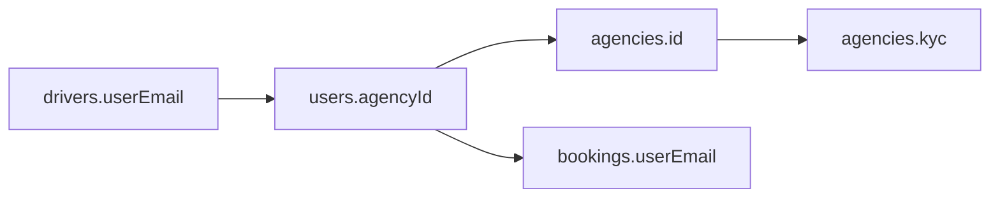

# Data — `users` dan `agencies`

## `users`

Menyimpan akun semua peran. Login memakai `email` + `pass`.

| Field | Tipe | Keterangan |
| :--- | :--- | :--- |
| `id` | string | `U-...` |
| `name` | string | Nama tampilan |
| `email` | string | **Kunci login**, case-insensitive saat dibandingkan |
| `phone` | string | Nomor HP |
| `pass` | string | Password plaintext (demo) |
| `role` | string | `pelanggan`, `agen`, `pengemudi`, `superadmin` |
| `agencyId` | string/null | Agen tempat user bernaung |
| `status` | string | `active`, `pending`, `nonaktif`/`suspended` |
| `photo` | string | Data URL/foto |
| `favorites` | array | Kontak favorit pelanggan `{name, phone}` |
| `profileStep` | string | `done` untuk pengemudi yang profilnya lengkap |

### Aturan

- `email` unik secara praktik; registrasi menolak email yang sudah ada.
- `pass` tidak di-hash. Ini simulasi, bukan pola produksi.
- `superadmin` tidak punya `agencyId`.
- `agen` harus punya `agencyId`.
- `pengemudi` punya `agencyId` dan biasanya terhubung ke `drivers.userEmail`.

### Fungsi terkait

- `currentUser()` — baca session lalu cari user.
- `setSession(u)` — simpan/hapus `at_session`.
- `checkAccountAccess(u)` — cek status dan agen induk.
- `driverParentIssue(u)` — pengemudi terkunci jika agen nonaktif.
- `createManagedAccount()` — buat akun dari panel admin/agen.

## `agencies`

| Field | Tipe | Keterangan |
| :--- | :--- | :--- |
| `id` | string | `AG1`, `AG2`, ... |
| `name` | string | Nama travel |
| `logo` | string | URL/data URL |
| `address`, `phone`, `bank` | string | Profil kontak |
| `status` | string | `active`, `pending`, `suspended` |
| `serviceFee` | number | Jasa agen per kursi; dipakai `splitFare()` |
| `feeType`, `feeValue` | string/number | Fee agen lama; tidak dipakai `splitFare()` |
| `refundPolicy` | array | `[{ minH, pct }]` |
| `rating`, `trips` | number | Statistik tampilan |
| `kyc` | object | Data KYC lengkap |
| `phone`, `address`, `bank` | string | Hasil sinkron KYC; `bank` berisi bank + rekening + a.n. |

### `kyc`

Bentuk utama:

```text
{
  jenis, nama, nik, tmpLahir, tglLahir, gender, agama,
  alamat: { jalan, rtRw, kelurahan, kecamatan, kota, provinsi, kodePos },
  hp, email,
  darurat: { nama, hubungan, hp },
  bank, rekeningNo, rekeningNama,
  npwpSamaKtp, npwp,
  badanNama, badanBentuk, aktaNo, npwpUsaha, nib, direktur, alamatUsaha,
  docs: { ktp, pasfoto, bukuTabungan, npwpPribadi, npwpUsaha, nib, akta, kantorDepan, kantorDalam },
  status: 'draft' | 'diajukan' | 'lengkap',
  step, terms, submittedAt, updatedAt
}
```

### Aturan

- Agen `pending` boleh login tetapi hanya bisa membuka KYC.
- KYC disetujui admin → `agencies.status = 'active'`.
- `agencyProfileFromKyc()` menyalin data KYC ke field profil agar mudah ditampilkan.
- `refundPolicy` disimpan per agen dan dipakai `refundRuleFor()`.
- `feeValue` di agen berbeda dari fee platform global di `settings`.

## Relasi



## Sumber

- `transaceh-react/src/lib/seed.js:74-97` — contoh user dan agen.
- `transaceh-react/src/lib/seed.js:15-69` — contoh KYC.
- `transaceh-react/src/lib/domain.js:23-107` — status dan akses.
- `transaceh-react/src/lib/domain.js:139-333` — manajemen akun.
- `transaceh-react/src/lib/domain.js:335-365` — profil agen.
- `transaceh-react/src/pages/Auth.jsx:144-158` — registrasi pelanggan.

Lihat [[Alur KYC dan Onboarding Agen]] dan [[Data - vehicles dan drivers]].
