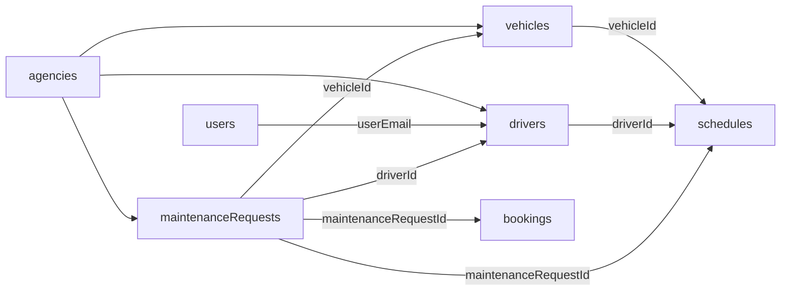

# Data — `vehicles` dan `drivers`

## `vehicles` (armada)

Objek armada cukup besar karena menyatukan identitas, dokumen, pemilik, operasi, dan pengemudi.

| Kelompok | Field utama |
| :--- | :--- |
| Identitas | `id`, `agencyId`, `brand`, `model`, `year`, `color`, `plate`, `chassis`, `engine`, `vtype`, `vtypeOther`, `baggage`, `capacity`, `photo`, `facilities`, `status` |
| Legal | `tax`, `stnkExp`, `kir`, `condition`, `docs`, `docOther`, `stnkPhoto`, `ktpOwnerPhoto` |
| Pemilik | `ownerName`, `ownerBiz`, `ownerNik`, `ownerAddr`, `ownerPhone`, `ownerEmail`, `ownership`, `coopDriverId`, `hasEmail` |
| Operasi | `mainRoute`, `origin`, `dest`, `freq`, `freqOther`, `services`, `opSchedule`, `coopTariff`, `coopSys`, `coopOther`, `fleetCount` |
| Pengemudi | `hasDriver`, `drvName`, `drvPhone`, `drvSim`, `drvSimExp`, `drvExp`, `hasBackup`, `backName`, `backPhone`, `backSim`, `backSimExp` |
| Kursi | `layout`, `inactiveSeats` |
| Maintenance | `maintenanceFrom`, `maintenanceUntil`, `maintenanceRequestId` (cache legacy) |

### Status armada

- `aktif` — bisa dipakai jadwal.
- `maintenance` — **legacy**: memblokir semua tanggal. Opsi ini hanya dipertahankan untuk data lama; kendaraan baru tidak bisa memilih status ini dari form.
- Nilai lain diperlakukan tidak tersedia oleh `fleetAvailable`.

### Maintenance berbasis periode

Sumber utama adalah koleksi `maintenanceRequests`:

- Pengemudi mengajukan periode maksimal 2 hari.
- Agen menyetujui/menolak di tab Armada.
- Approval **tidak** mengubah `vehicles.status`; armada tetap `aktif`.
- `vehicleMaintenanceOn(vehicleId, date)` memeriksa request `disetujui` pada tanggal itu, lalu fallback ke status legacy.
- `vehicleMaintenancePeriods()` dan `vehicleMaintenanceLabel()` dipakai untuk badge periode di Fleet.
- `VehForm` menyimpan `maintenanceFrom/Until/RequestId` kosong; periode authoritative tetap di request.

### Layout kursi

- `layout` opsional, array 28 sel `{ sid, type }`.
- `vehLayout(v)` memakai `layout` jika ada; jika tidak, membuat layout default:
  - 2 kursi driver (`DRV`, `DRV2`),
  - 6 kursi `A1`–`A6`,
  - 4 area bagasi,
  - sisanya kosong.
- `inactiveSeats` mengubah sel menjadi `off`.
- `vehSeatCount()` menghitung sel bertipe `seat`.
- `capacity` di data seed = 6, sesuai layout default.

> [!warning] Kapasitas vs layout
> `schedSeatCap()` memakai `vehSeatCount()`, bukan `capacity`. Jika layout diubah, kapasitas jadwal ikut berubah.

## `drivers` (pengemudi)

| Field | Keterangan |
| :--- | :--- |
| `id` | `D...` |
| `agencyId` | Agen induk |
| `name`, `phone` | Identitas |
| `simType`, `simExp`, `simNumber`, `simPhoto` | SIM |
| `ktpPhoto`, `selfie`, `photo` | Dokumen/foto |
| `status` | `aktif` / `nonaktif` |
| `rating`, `trips` | Statistik |
| `userEmail` | Penghubung ke `users.email` |
| `birthPlace`, `birthDate`, `gender`, `address`, `nik` | Data pribadi |
| `marital`, `education` | Data tambahan |
| `emName`, `emPhone`, `emRelation` | Kontak darurat |
| `bank` | Info rekening |

### Aturan

- Pengemudi harus terhubung ke agen (`agencyId`).
- `drvOfUser(user)` mencari driver dengan `userEmail`, fallback driver pertama di agen (dipakai panel tugas lama).
- `driverForUser(user)` **tanpa fallback**; dipakai maintenance agar akun agen/admin tidak dianggap pengemudi.
- `driverParentIssue(user)` memblokir pengemudi jika agen induk tidak aktif.
- `simExpired()` membandingkan tahun `simExp` dengan tahun sekarang.
- Profil pengemudi bisa memiliki status verifikasi; lihat `driverProfileStatus()` dan `approveDriverProfile()`.
- Satu armada dapat menunjuk pengemudi utama dan cadangan; saat jadwal dibuat, data ini dipakai untuk mengisi `driverId`/`backupDriverId`.

## Relasi

## Sumber

- `transaceh-react/src/lib/seed.js:99-117` — contoh armada dan pengemudi.
- `transaceh-react/src/lib/domain.js:411-687` — helper armada/pengemudi dan `driverForUser`.
- `transaceh-react/src/lib/domain.js:689-790` — helper maintenance armada.
- `transaceh-react/src/lib/domain.js:1470-1535` — penyelesaian periode maintenance.
- `transaceh-react/src/agen/VehForm.jsx:311-314, 394-395` — pembersihan field periode dan status legacy.
- `transaceh-react/src/agen/Fleet.jsx:17-37` — label/riwayat maintenance armada.
- `transaceh-react/src/driver/Maintenance.jsx` — pengajuan pengemudi.
- `transaceh-react/src/agen/DrvForm.jsx` — form pengemudi.

Lihat [[Alur Pengemudi]] dan [[Data - schedules dan bookings]].
