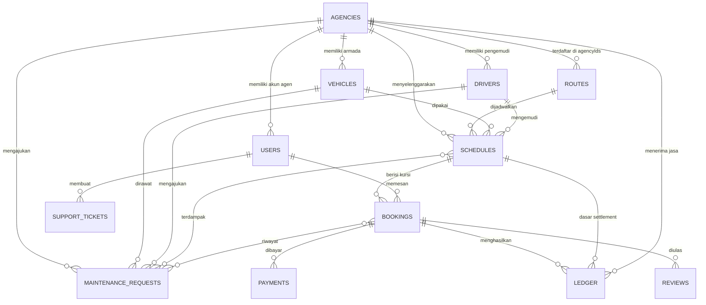

# ERD dan Relasi

## Diagram

> [!info] Ini ERD logis
> Mermaid menggambarkan hubungan konseptual. Di `localStorage` tidak ada constraint; semua relasi adalah string ID/email yang disimpan di field.

## Relasi kunci

| Dari | Ke | Field | Sifat |
| :--- | :--- | :--- | :--- |
| `users` | `agencies` | `agencyId` | banyak user ke satu agen |
| `drivers` | `users` | `userEmail` | satu driver biasanya satu akun |
| `schedules` | `routes` | `routeId` | satu rute banyak jadwal |
| `schedules` | `vehicles` | `vehicleId` | satu armada banyak jadwal |
| `schedules` | `drivers` | `driverId`, `backupDriverId` | pengemudi utama + cadangan |
| `bookings` | `schedules` | `scheduleId` | satu jadwal banyak booking |
| `bookings` | `schedules` | `maintenanceOriginalScheduleId`, `replacementScheduleId` | riwayat pindah maintenance |
| `bookings` | `maintenanceRequests` | `maintenanceRequestId` | request yang sedang/terakhir menangani booking |
| `schedules` | `maintenanceRequests` | `maintenanceRequestId` | request yang memblokir jadwal |
| `maintenanceRequests` | `vehicles`, `drivers`, `agencies` | `vehicleId`, `driverId`, `agencyId` | pemohon dan armada |
| `bookings` | `users` | `userEmail` | booking pelanggan; `null` untuk booking driver |
| `payments` | `bookings` | `bookingId` | satu-satu |
| `ledger` | `bookings` | `bookingId` | satu-satu |
| `ledger` | `schedules` | `scheduleId` | banyak ledger per jadwal |
| `routes` | `agencies` | `agencyIds`, `prices`, `suspensions` | many-to-many |
| `routes` | `vehicles` | `vehicleIds` | armada yang terhubung |
| `routeRequests` | `agencies` | `agencyId` | usulan per agen |
| `supportTickets` | `users` | `userEmail` / `userId` | tiket pelanggan atau guest |

## Relasi yang mudah putus

- Menghapus `users` tidak menghapus `bookings`, `ledger`, atau `supportTickets`.
- Menghapus `vehicles` tidak membersihkan `schedules`, `routes.vehicleIds`, atau `maintenanceRequests`.
- Menghapus `schedules` setelah booking dipindahkan maintenance meninggalkan `maintenanceOriginalScheduleId` yang dangling.
- Menghapus `routes` tidak membersihkan `schedules`, `routeRequests`, atau `ledger`.
- Mengganti `email` user membuat booking lama tidak lagi cocok dengan `userEmail`.
- `bookings.fare` adalah snapshot; jika tarif berubah, data lama tetap memakai snapshot.

## Sumber

- `transaceh-react/src/lib/seed.js:74-132` — objek awal.
- `transaceh-react/src/lib/domain.js:2567-2638` — pembuatan rute dari request.
- `transaceh-react/src/pages/Search.jsx:263-277` — booking + payment.
- `transaceh-react/src/lib/domain.js:1878-1886` — ledger.
- `transaceh-react/src/lib/domain.js:833-883` — pembuatan maintenance request.
- `transaceh-react/src/lib/domain.js:938-1001` — relasi booking ↔ request.

Lihat [[00 Data Model MOC]].
