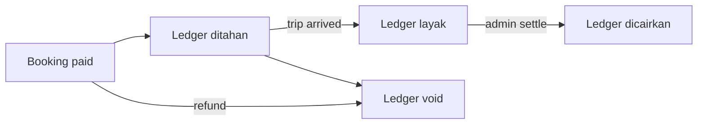
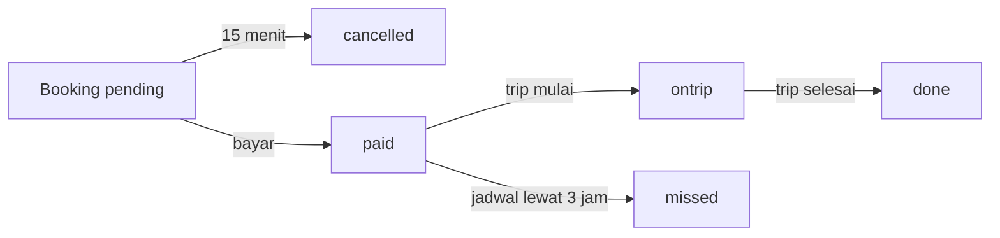

# Alur Bisnis — MOC

## Peta alur

| Alur | Inti | Status kunci |
| :--- | :--- | :--- |
| [[Alur Booking dan Checkout]] | Pelanggan memilih rute, tanggal, armada, kursi, lalu checkout | `pending` |
| [[Alur Pembayaran dan Hold]] | Simulasi bayar dan hold 15 menit | `paid` / `cancelled` |
| [[Alur Pembatalan dan Refund]] | Refund tiket sesuai kebijakan agen | `pending` → `done` |
| [[Alur Siklus Jadwal]] | Jadwal berjalan otomatis mengikuti waktu | `scheduled` → `ontrip` → `arrived` |
| [[Alur Boarding dan No-show]] | Manifest, boarding, dan jadwal tidak berangkat | `boarded` / `missed` |
| [[Alur Ledger dan Settlement]] | Bagi hasil tiket, jasa agen, fee platform | `ditahan` → `layak` → `dicairkan` |
| [[Alur KYC dan Onboarding Agen]] | Agen baru lengkapi data dan disetujui admin | `pending` → `active` |
| [[Alur Pengemudi]] | Tugas, trip, kursi, tiket offline, dompet | `ontrip` / `arrived` |
| [[Alur Pengajuan Rute]] | Agen usul rute/harga/titik jemput | `pending` → `approved` |
| [[Alur Support dan Chat AI]] | Tiket bantuan dan chatbot | `new` → `resolved` |

## Alur uang

## Alur waktu

## Cara membaca

1. Mulai dari [[Alur Booking dan Checkout]] untuk memahami input.
2. Lanjut ke [[Alur Pembayaran dan Hold]] dan [[Alur Pembatalan dan Refund]].
3. Baca [[Alur Siklus Jadwal]] dan [[Alur Ledger dan Settlement]] untuk sisi operasional.
4. Untuk peran, lanjut ke [[00 Modul MOC]].
