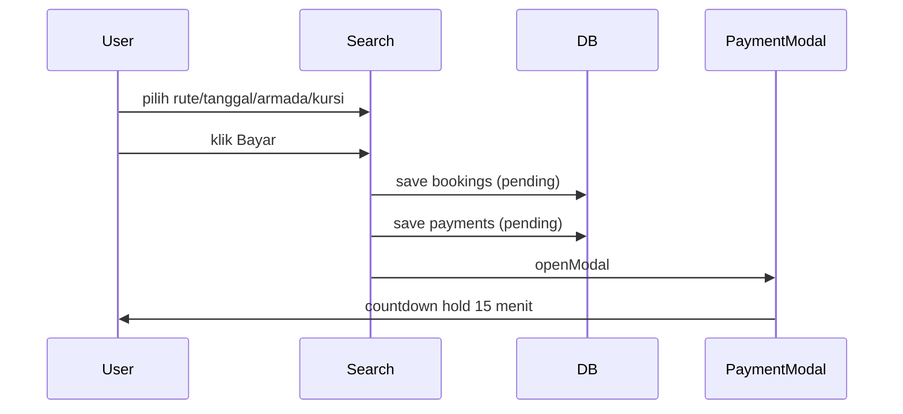

# Alur Booking dan Checkout

## Ringkas

Wizard 5 langkah di `Search.jsx`:

1. **Rute** — pilih grup rute.
2. **Tanggal** — 0–30 hari ke depan.
3. **Armada** — pilih jadwal/armada.
4. **Kursi** — pilih kursi, isi penumpang, titik jemput, voucher.
5. **Bayar** — ringkasan dan tombol bayar.

## Detail per langkah

### 1. Rute

- `groupRoutes(DB.load('routes'))` mengelompokkan rute bolak-balik.
- Hanya rute `active` dan `routeBookable()` yang ditampilkan.
- Memilih grup mengisi `bw.routeId` dan mereset pilihan berikutnya.

### 2. Tanggal

- Loop `todayStr(0)` sampai `todayStr(30)`.
- Menghitung jumlah jadwal `schedReady()` dan `seatsLeft() > 0`.
- Rute yang disuspend untuk agen tertentu tidak dihitung.
- Tanggal tanpa armada tetap tampil merah.

### 3. Armada

- `stepSchedules()` memfilter jadwal pada tanggal terpilih.
- Menampilkan armada, jam, harga, sisa kursi, fasilitas.
- Memilih jadwal mengisi `bw.scheduleId`.

### 4. Kursi dan penumpang

- `CabinGrid` menampilkan layout dari `vehLayout`.
- Kursi terisi/hold/blokir/nonaktif tidak bisa dipilih.
- Maksimal kursi = `schedSeatCap()`.
- Setiap kursi punya data penumpang `{ seat, name, phone }`.
- Titik jemput:
  - `HOME_PICKUP` untuk jemput rumah + alamat + koordinat `MapPicker`.
  - Pilihan terminal dari `pickupOptions(route)`.
- Voucher dihitung `calcDiscount()`; `used` baru bertambah saat checkout.

### 5. Ringkasan dan bayar

- Menampilkan rute, tanggal, armada, kursi, penumpang, jemput, diskon, total.
- Jika tamu menekan **Bayar**:
  - `saveCheckoutDraft(bw)` menyimpan ke `at_checkout_draft` (TTL 30 menit).
  - Diarahkan ke `login`.
  - Setelah login/daftar, `resumeCheckout()` mengembalikan draft dan langsung ke ringkasan.
- Jika sudah login:
  - Validasi jadwal masih `schedReady`.
  - Cek bentrok kursi sekali lagi.
  - Buat booking `pending` + payment `pending`.
  - Buka `PaymentModal`.

## Urutan data

## Kondisi gagal

- Jadwal hilang/berangkat → toast dan kembali ke langkah 3.
- Kursi sudah diambil → kursi dihapus dari pilihan.
- Tamu belum login → draft disimpan, bukan booking.
- Voucher tidak valid → diskon 0.
- Kapasitas penuh → tidak bisa memilih kursi baru.

## Sumber

- `transaceh-react/src/pages/Search.jsx:19` — label langkah.
- `transaceh-react/src/pages/Search.jsx:207-234` — kursi dan voucher.
- `transaceh-react/src/pages/Search.jsx:236-286` — checkout.
- `transaceh-react/src/pages/Search.jsx:315-476` — langkah 2–5.
- `transaceh-react/src/lib/checkoutDraft.js:17-65` — draft tamu.
- `transaceh-react/src/pages/Auth.jsx:12-30` — resume setelah auth.

Lihat [[Alur Pembayaran dan Hold]] dan [[Data - schedules dan bookings]].
