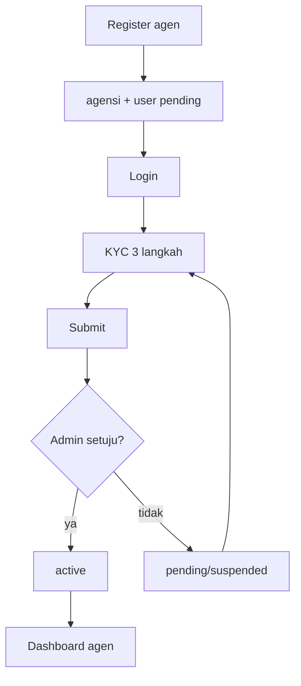

# Alur KYC dan Onboarding Agen

## 1. Registrasi agen

`RegisterAgency` di `Auth.jsx`:

- Validasi akun + nama/alamat travel.
- Membuat `agencies` baru:
  - `status: 'pending'`,
  - `feeType: 'percent'`, `feeValue: 8`,
  - `refundPolicy` default 72/24/0 jam,
  - `rating: 5.0`, `trips: 0`.
- Membuat `users` baru:
  - `role: 'agen'`,
  - `agencyId` baru,
  - `status: 'pending'`.

Setelah daftar, agen diarahkan ke login.

## 2. Login agen pending

- `checkAgenAccess()` mengizinkan status `pending`, tetapi menolak `suspended`.
- `agencyPending()` true jika user/agen `pending` **atau** KYC belum lengkap.
- `landAfterAuth()` mengarahkan agen pending ke `agen-pending` (KYC), bukan dashboard.

## 3. KYC 3 langkah

`KycWizard.jsx`:

| Langkah | Isi |
| :--- | :--- |
| 1. Kelengkapan Data | Jenis agen, identitas, alamat, kontak darurat, bank, NPWP |
| 2. Lampiran Dokumen | Upload KTP, pasfoto, buku tabungan, NPWP, dokumen badan usaha |
| 3. Syarat & Ketentuan | Centang persetujuan, submit |

### Validasi penting

- Usia minimal 21 tahun (`KYC_MIN_AGE`).
- Alamat wajib lengkap: provinsi, kota, kecamatan, kelurahan, RT/RW, jalan, kode pos 5 digit.
- NIK 16 digit.
- Nomor HP valid.
- Rekening bank wajib.
- Dokumen wajib per jenis agen.
- Total ukuran dokumen dibatasi `DOCS_BUDGET_BYTES`.
- Tipe file dibatasi `DOC_ACCEPT`.

### Dokumen

`kycDocGroups()` dan `kycDocWajib()` menentukan dokumen berdasarkan:

- **Perorangan/Freelance**: KTP, pasfoto, buku tabungan, NPWP pribadi.
- **Badan Usaha (PT/CV)**: KTP, NPWP usaha, NIB, akta, buku tabungan, foto kantor.

## 4. Penyimpanan

- KYC disimpan di `agencies.kyc`.
- `syncAgencyProfileFromKyc()` menyalin phone/address/bank ke field profil agen.
- Setelah submit: `step: 3`; status KYC `diajukan` untuk agen baru, atau `lengkap` untuk agen lama yang melengkapi data.
- Agen baru tetap `pending` sampai admin menyetujui pengajuan.

## 5. Persetujuan admin

Di `admin/Agencies.jsx`:

- Admin melihat kelengkapan dan dokumen.
- Menyetujui → `agencies.status = 'active'` dan akun agen aktif.
- Menolak/menonaktifkan → agen tidak bisa operasi.
- `setAgencyStatusWithAccounts()` juga menonaktifkan/mengaktifkan akun agen dan pengemudi di bawahnya.
- Menonaktifkan agen dicegah jika masih ada jadwal aktif yang memakai pengemudi terkait.

## Diagram

## Sumber

- `transaceh-react/src/pages/Auth.jsx:190-210` — registrasi agen.
- `transaceh-react/src/pages/Auth.jsx:23-27` — redirect agen pending.
- `transaceh-react/src/agen/KycWizard.jsx:17-150` — langkah KYC.
- `transaceh-react/src/lib/domain.js:1922-2089` — konstanta, validasi, dokumen, profil.
- `transaceh-react/src/lib/domain.js:289-310` — status agen dan akun anak.
- `transaceh-react/src/admin/Agencies.jsx` — persetujuan admin.

Lihat [[Data - users dan agencies]] dan [[Modul Agen]].
