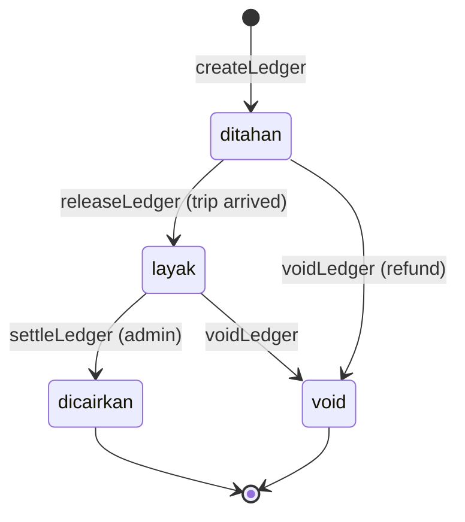

# Alur Ledger dan Settlement

## Pembagian tarif

`splitFare(schedule, nSeats, discount, source)` di `domain.js:1791`.

```text
paid    = harga × kursi − diskon
base    = paid / (1 + fee%)        (fee percent, inklusif)
service = min(jasaAgen × kursi, base)
ticket  = base − service
fee     = paid − base
```

Untuk fee `flat`:

```text
base = max(0, paid − feeFlat)
```

Untuk booking yang dibuat pengemudi (`source = 'driver'`), `service = 0`; seluruh `base` menjadi `ticket`.

### Contoh

Harga 170.000, 1 kursi, tanpa diskon, fee platform 8%, jasa agen 10.000:

| Komponen | Nilai |
| :--- | ---: |
| Dibayar | 170.000 |
| Base | 157.407 |
| Jasa agen | 10.000 |
| Tiket pengemudi | 147.407 |
| Fee platform | 12.593 |

Angka dibulatkan dengan `Math.round`.

## Ledger

Dibuat saat booking menjadi `paid`:

```text
status = 'ditahan'
```

Transisi:



Aturan:

- `createLedger` idempoten per booking.
- `releaseLedger(scheduleId)` merilis semua ledger `ditahan` saat jadwal `arrived`.
- `voidLedger(bookingId)` hanya mengubah yang belum `dicairkan`.
- `settleLedger(ids)` hanya mencairkan yang `layak`.
- `ledgerEligible(e)` butuh 24 jam sejak `arrivedAt`/`releasedAt`.
- Ledger `dicairkan` tidak bisa dibatalkan otomatis.
- Pindah armada maintenance memindahkan ledger `ditahan`/`layak` ke booking dan jadwal tujuan; `agencyId`, `driverId`, kursi, dan nominal ikut disesuaikan.
- Refund maintenance 100% memakai `voidLedger`; ledger yang sudah cair tetap harus manual.

## Siapa melihat apa

| Peran | Komponen | Halaman |
| :--- | :--- | :--- |
| Pengemudi | `ticket` | `driver/Wallet.jsx` |
| Agen | `service` | `agen/Finance.jsx` |
| Superadmin | `fee`, GMV, settlement | `admin/Overview.jsx`, `admin/Settlement.jsx` |

## Settlement admin

`admin/Settlement.jsx`:

- Menampilkan semua ledger `layak`; yang belum 24 jam ditandai `Kliring <24 jam`.
- `readyIds` dipakai untuk "pilih semua yang siap", tetapi checkbox individual masih bisa dipilih.
- `settleLedger(ids)` **tidak** memeriksa `ledgerEligible`; ia hanya mencairkan status `layak`. Jadi kliring 24 jam adalah sinyal UI, bukan guard keras.
- Admin memilih pos lalu `settleLedger`.
- Status menjadi `dicairkan`, `paidOutAt` diisi.
- Tidak ada transfer bank nyata; hanya perubahan status.

## Refund dan ledger

- Refund pelanggan → ledger `void` (jika belum cair).
- Pembatalan operator/no-show → semua ledger jadwal `void`.
- Refund maintenance 100% → ledger booking `void`; pindah armada → ledger dipindahkan ke jadwal tujuan.
- Jika ledger sudah `dicairkan`, refund otomatis ditolak dan harus diselesaikan manual.

## Sumber

- `transaceh-react/src/lib/domain.js:1791-1830` — `splitFare`.
- `transaceh-react/src/lib/domain.js:1878-1932` — create/release/void.
- `transaceh-react/src/lib/domain.js:2519-2535` — settle/eligibility.
- `transaceh-react/src/lib/domain.js:2362` — release saat arrived.
- `transaceh-react/src/lib/domain.js:1187-1296` — refund dan pindah ledger maintenance.
- `transaceh-react/src/admin/Settlement.jsx` — UI settlement.
- `transaceh-react/src/agen/Finance.jsx` — ringkasan agen.
- `transaceh-react/src/driver/Wallet.jsx` — dompet pengemudi.

Lihat [[Data - payments dan ledger]] dan [[Alur Pembatalan dan Refund]].
