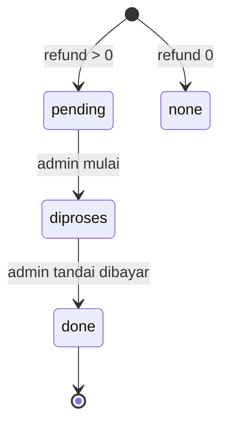

# Alur Pembatalan dan Refund

Ada tiga jalur pembatalan dengan dasar refund berbeda.

## 1. Pelanggan / agen membatalkan booking

`cancelBooking(bookingId, { reason, by })`

Syarat `canCancelBooking()`:

- status booking `pending` atau `paid`,
- belum `boarded`,
- jadwal belum `ontrip`, `arrived`, `missed`, atau `cancelled`,
- jadwal belum lewat.

Perhitungan:

- Booking `pending` → refund 0.
- Booking `paid` → refund **hanya komponen tiket** × persentase kebijakan agen.
- `refundScope = 'ticket'`.
- `refundStatus = 'pending'` jika refund > 0.
- Voucher dikembalikan.
- Ledger di-`void` jika belum dicairkan.
- Payment disinkronkan lewat `updatePaymentRefund()`.

## 2. Operator membatalkan jadwal

`cancelScheduleByOperator(sid, reason, by)`

Syarat:

- alasan wajib,
- belum `ontrip`/`arrived`/`missed`,
- belum lewat,
- belum ada ledger yang dicairkan.

Dampak:

- Semua booking `paid` direfund **100% dari total pembayaran** (`refundScope = 'total'`).
- Booking `pending` dibatalkan tanpa refund.
- Semua ledger belum dicairkan → `void`.
- Jadwal `cancelled` + `reviewResult = 'operator_cancel'`.
- Admin mendapat notifikasi.

## 3. Admin menandai jadwal tidak berangkat (no-show)

`resolveScheduleNoShow(sid, refundPct)`

Dipakai dari `admin/Settlement.jsx`.

- Hanya untuk jadwal di antrean review.
- Refund dihitung dari **total pembayaran** × persentase yang dipilih admin.
- `refundScope = 'total'` jika 100%, `'partial'` jika kurang.
- Booking `paid` → `cancelled`, `tripStatus = 'missed'`.
- Booking `pending` → `cancelled`, tanpa refund.
- Ledger belum dicairkan → `void`.
- Jadwal `reviewResult = 'no_show'`.

> [!important] Dasar refund berbeda
> Pembatalan pelanggan = hanya tiket. Pembatalan operator / no-show / maintenance = total pembayaran (tiket + jasa + fee).

## 4. Maintenance armada

Pengajuan driver → persetujuan agen. Approval tidak membatalkan jadwal secara hard; jadwal pada periode ditandai maintenance dan tidak bisa dijual. Resolusi booking:

| Kondisi booking | Tindakan |
| :--- | :--- |
| `pending` | `cancelled`, refund 0, payment `cancelled` |
| `paid`, ada pengganti valid + akun pelanggan | `choice_pending`; pelanggan memilih refund 100% atau pindah |
| `paid`, tidak ada pengganti / tanpa akun | refund 100% total otomatis |
| `boarded` / trip berjalan | tidak disentuh; perjalanan lanjut |
| `done` / sudah lampau | tidak disentuh |

Aturan pengganti:

- Agensi, arah rute, tanggal, dan harga harus sama.
- Kursi cukup, bukan armada asal, jadwal `open`, belum berjalan, dan bukan maintenance.
- Pelanggan memilih langsung dari tiket; tidak ada approval agen per tiket karena kandidat sudah divalidasi domain.
- Deadline: 24 jam sebelum keberangkatan efektif, minimal 2 jam setelah approval, dan paling lambat 30 menit sebelum berangkat. Jika lewat/no candidate → refund 100% otomatis. Approval yang terjadi kurang dari 30 menit sebelum berangkat langsung memicu refund.
- Refund memakai `refundScope = 'total'`; ledger belum cair di-void. Pindah armada memindahkan kursi, penumpang, dan ledger ke jadwal tujuan.
- Notifikasi pelanggan memuat jadwal, nominal refund, detail pengganti, deadline, dan fallback. Booking tanpa akun mengirim notifikasi ke pengemudi pengaju.

## Status refund

- `startRefundProcessing()` → booking/payment `diproses`.
- `markRefundPaid()` → booking/payment `done`, payment `refunded`.
- Refund tidak memotong ledger lagi karena ledger sudah `void`.

## Kebijakan agen

Default:

| Jam sebelum berangkat | Refund tiket |
| ---: | ---: |
| ≥ 72 jam | 100% |
| ≥ 24 jam | 50% |
| < 24 jam | 0% |

Disimpan di `agencies.refundPolicy`, dinormalisasi `normalizeRefundPolicy()`.

## Sumber

- `transaceh-react/src/lib/domain.js:1810-1877` — kebijakan refund.
- `transaceh-react/src/lib/domain.js:1962-2080` — batal pelanggan dan proses refund.
- `transaceh-react/src/lib/domain.js:2081-2189` — batal operator.
- `transaceh-react/src/lib/domain.js:2421-2518` — no-show admin.
- `transaceh-react/src/lib/domain.js:1002-1296` — approval maintenance, refund/pindah.
- `transaceh-react/src/admin/Refunds.jsx` — UI refund.
- `transaceh-react/src/pages/TicketDetail.jsx:47-52, 119-133, 176-223` — panel maintenance pelanggan.

Lihat [[Alur Ledger dan Settlement]] dan [[Data - payments dan ledger]].
