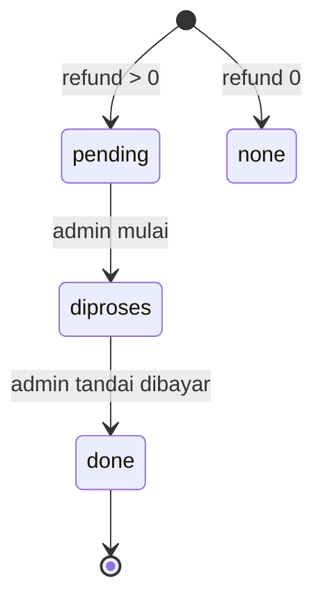

# Alur Pembatalan dan Refund

Ada tiga jalur pembatalan dengan dasar refund berbeda.

## 1. Pelanggan / agen membatalkan booking

`cancelBooking(bookingId, { reason, by })`

Syarat `canCancelBooking()`:

- status booking `pending` atau `paid`,
- belum `boarded`,
- jadwal belum `ontrip`, `arrived`, `missed`, atau `cancelled`,
- jadwal belum lewat.

Perhitungan:

- Booking `pending` → refund 0.
- Booking `paid` → refund **hanya komponen tiket** × persentase kebijakan agen.
- `refundScope = 'ticket'`.
- `refundStatus = 'pending'` jika refund > 0.
- Voucher dikembalikan.
- Ledger di-`void` jika belum dicairkan.
- Payment disinkronkan lewat `updatePaymentRefund()`.

## 2. Operator membatalkan jadwal

`cancelScheduleByOperator(sid, reason, by)`

Syarat:

- alasan wajib,
- belum `ontrip`/`arrived`/`missed`,
- belum lewat,
- belum ada ledger yang dicairkan.

Dampak:

- Semua booking `paid` direfund **100% dari total pembayaran** (`refundScope = 'total'`).
- Booking `pending` dibatalkan tanpa refund.
- Semua ledger belum dicairkan → `void`.
- Jadwal `cancelled` + `reviewResult = 'operator_cancel'`.
- Admin mendapat notifikasi.

## 3. Admin menandai jadwal tidak berangkat (no-show)

`resolveScheduleNoShow(sid, refundPct)`

Dipakai dari `admin/Settlement.jsx`.

- Hanya untuk jadwal di antrean review.
- Refund dihitung dari **total pembayaran** × persentase yang dipilih admin.
- `refundScope = 'total'` jika 100%, `'partial'` jika kurang.
- Booking `paid` → `cancelled`, `tripStatus = 'missed'`.
- Booking `pending` → `cancelled`, tanpa refund.
- Ledger belum dicairkan → `void`.
- Jadwal `reviewResult = 'no_show'`.

> [!important] Dasar refund berbeda
> Pembatalan pelanggan = hanya tiket. Pembatalan operator / no-show = total pembayaran (tiket + jasa + fee).

## Status refund

- `startRefundProcessing()` → booking/payment `diproses`.
- `markRefundPaid()` → booking/payment `done`, payment `refunded`.
- Refund tidak memotong ledger lagi karena ledger sudah `void`.

## Kebijakan agen

Default:

| Jam sebelum berangkat | Refund tiket |
| ---: | ---: |
| ≥ 72 jam | 100% |
| ≥ 24 jam | 50% |
| < 24 jam | 0% |

Disimpan di `agencies.refundPolicy`, dinormalisasi `normalizeRefundPolicy()`.

## Sumber

- `transaceh-react/src/lib/domain.js:1114-1184` — kebijakan refund.
- `transaceh-react/src/lib/domain.js:1256-1314` — batal pelanggan.
- `transaceh-react/src/lib/domain.js:1316-1378` — proses refund.
- `transaceh-react/src/lib/domain.js:1384-1486` — batal operator.
- `transaceh-react/src/lib/domain.js:1715-1812` — no-show admin.
- `transaceh-react/src/admin/Refunds.jsx` — UI refund.

Lihat [[Alur Ledger dan Settlement]] dan [[Data - payments dan ledger]].
