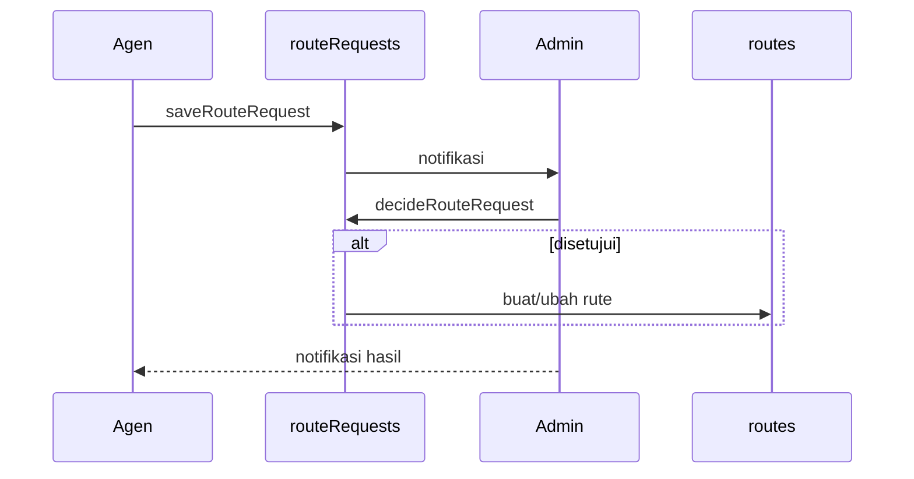

# Alur Pengajuan Rute

## Model hibrida

Agen **mengusulkan**, admin **mengeksekusi**. Agen tidak bisa langsung membuat rute global.

## Jenis usulan

| Tipe | Tujuan |
| :--- | :--- |
| `rute-baru` | Membuat rute baru |
| `ubah-harga` | Mengubah harga agen pada rute |
| `titik-jemput` | Menambah titik jemput |

## Form agen

`agen/Routes.jsx`:

- Pilih jenis usulan.
- Isi asal/tujuan.
- Estimasi jarak/durasi dari `estimateRoute`.
- Pilih titik jemput dari `PICKUP_ORIGIN` atau custom.
- Tentukan harga per kursi.
- Pilih armada aktif milik agen.
- Catatan tambahan.
- Kirim → `saveRouteRequest()`.

Validasi:

- Armada hanya yang `agencyId` sama dan `status = aktif`.
- Titik jemput dinormalisasi (trim, buang kosong/duplikat).
- Harga 0 diperbolehkan. Rute baru tetap dibuat `active` dengan `basePrice: 0` dan `prices: {}`; pastikan harga diisi sebelum dipublikasikan.

## Keputusan admin

`admin/Routes.jsx` → `decideRouteRequest(id, approve, note)`:

- Hanya request `pending` yang bisa diputuskan.
- `rute-baru`:
  - validasi armada,
  - buat `routes` baru,
  - `agencyIds = [agen]`,
  - `prices[agen] = harga`,
  - `pickups` diisi terminal + titik usulan,
  - estimasi jarak/durasi jika kosong.
- `ubah-harga`: update `prices[agen]`.
- `titik-jemput`: tambah titik tanpa duplikat.
- Status menjadi `approved`/`rejected` + `adminNote`.
- Agen mendapat notifikasi.

## Suspend rute

Admin dapat men-suspend rute **untuk agen tertentu**:

- `suspendAgencyRoute(routeId, agencyId, reason)`.
- Alasan wajib.
- `routes.suspensions[agencyId] = { reason, at }`.
- Agen terkait mendapat notifikasi.
- `activateAgencyRoute()` menghapus suspend.

Dampak:

- `routeOfferedTo()` false untuk agen itu.
- `isRouteSuspended()` membuat jadwal agen tersebut tidak tampil.
- Rute tetap bisa dipakai agen lain.

## Dari rute ke jadwal

- Rute harus `active`.
- Armada harus terhubung ke rute (`vehicleIds`) atau minimal satu agen.
- `SchedForm` hanya menampilkan rute yang cocok untuk armada/agen.
- Harga jadwal diambil dari `priceForAgency(route, agencyId)`.

## Diagram

## Sumber

- `transaceh-react/src/agen/Routes.jsx:10-130` — form dan tipe.
- `transaceh-react/src/lib/domain.js:1836-1916` — suspend dan keputusan.
- `transaceh-react/src/admin/Routes.jsx:10-130` — panel admin.
- `transaceh-react/src/agen/SchedForm.jsx:290-310` — rute untuk jadwal.

Lihat [[Data - routes dan routeRequests]] dan [[Modul Agen]].
