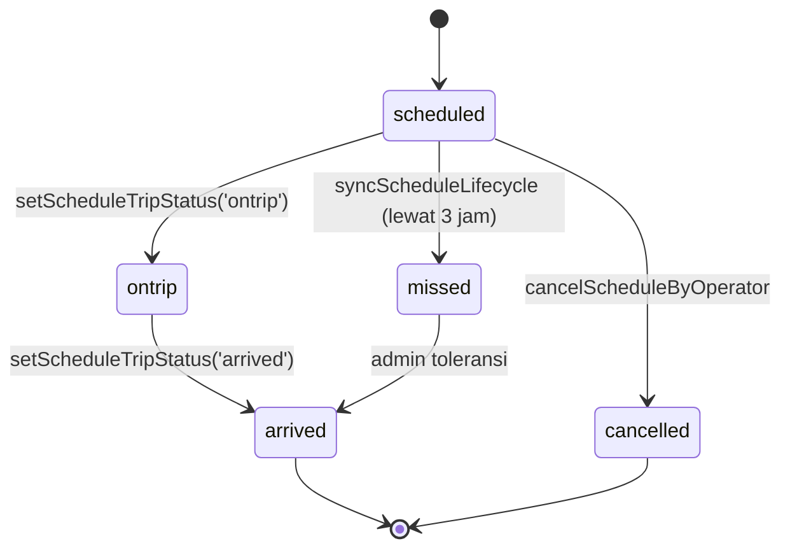

# Alur Siklus Jadwal

## Status

| Field | Nilai | Arti |
| :--- | :--- | :--- |
| `status` | `open` | Masih bisa dijual |
| `status` | `closed` | Tidak bisa dijual; trip berjalan/selesai |
| `status` | `cancelled` | Dibatalkan |
| `tripStatus` | `scheduled` | Belum berangkat |
| `tripStatus` | `ontrip` | Sedang berjalan |
| `tripStatus` | `arrived` | Selesai |
| `tripStatus` | `missed` | Lewat tanpa keberangkatan |
| `tripStatus` | `cancelled` | Dibatalkan |

## Pembuatan

`SchedForm`:

- Pilih armada dulu.
- Armada harus aktif dan terhubung ke rute.
- Rute mengikuti `vehicleIds`/agensi.
- Pengemudi utama diambil dari data armada; cadangan opsional.
- Harga otomatis dari `priceForAgency()`.
- Bisa pilih beberapa tanggal sekaligus.
- Bentrok jadwal dicek dengan durasi + buffer 30 menit.
- Jadwal disimpan `open` + `scheduled`.

## Perjalanan

### Mulai trip

`setScheduleTripStatus(sid, 'ontrip')`:

- Jadwal `closed`.
- `departedAt`, `departedBy`.
- Booking `pending` dibatalkan otomatis, termasuk yang sudah boarding.
- Booking `paid` menjadi `ontrip`.
- Notifikasi ke pelanggan.

### Selesai trip

`setScheduleTripStatus(sid, 'arrived')`:

- `arrivedAt`.
- `lateCompletion` jika sebelumnya `missed` atau lewat grace.
- Booking `paid` menjadi `done`.
- `releaseLedger(sid)` → ledger `layak`.

## Auto-close

`syncScheduleLifecycle()` berjalan:

- saat aplikasi dimuat,
- setiap 60 detik.

Aturan:

- Jadwal `scheduled` yang lewat **3 jam** (`SCHEDULE_GRACE_HOURS`) atau tanggal sudah lewat → `missed`.
- Jika ada penumpang `boarded`, jadwal diubah `ontrip` agar tidak dianggap terlewat.
- Booking aktif ikut `missed`, **kecuali** booking yang sudah `boarded`: cabang boarding mengubah jadwal dan booking menjadi `ontrip`.
- Jadwal `missed` tanpa booking aktif → `reviewResult = 'empty'` dan ditutup.
- `ontrip`/`arrived`/`missed` → `status = 'closed'`.

## Delay

`setScheduleDelay(sid, minutes, reason, note)`:

- Maksimal total delay 180 menit.
- `delayUntil`, `delayMinutes`, `delayReason`, `delayHistory`.
- Pelanggan diberi notifikasi.
- Delay tidak mengubah ETA `tripProgress`.

## Sumber

- `transaceh-react/src/lib/domain.js:692-771` — konstanta grace/buffer.
- `transaceh-react/src/lib/domain.js:851-910` — `syncScheduleLifecycle`.
- `transaceh-react/src/lib/domain.js:934-991` — delay.
- `transaceh-react/src/lib/domain.js:1636-1708` — status trip.
- `transaceh-react/src/agen/SchedForm.jsx:223-248` — pembuatan.
- `transaceh-react/src/driver/Tasks.jsx` — aksi pengemudi.

Lihat [[Alur Boarding dan No-show]] dan [[Data - schedules dan bookings]].
