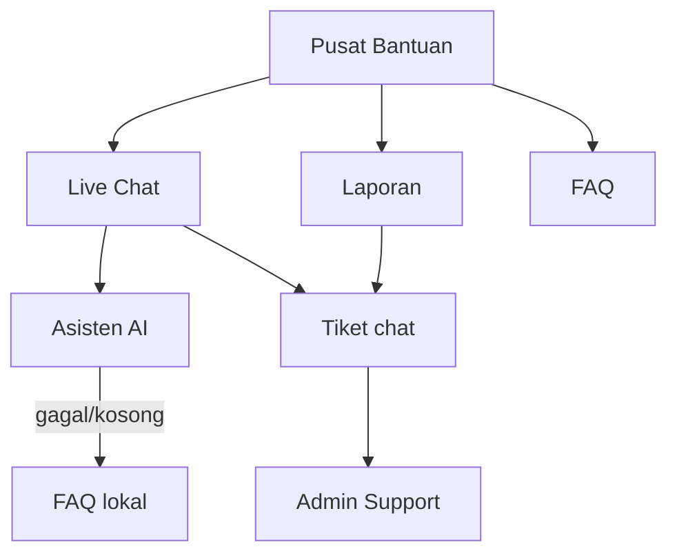
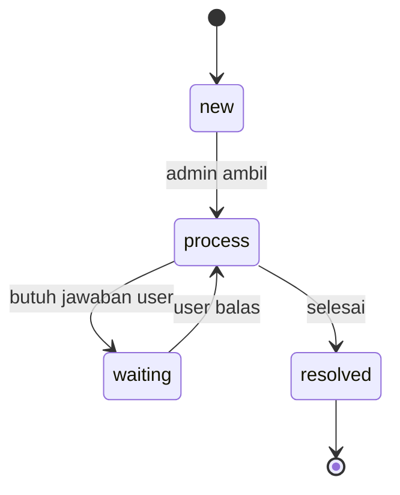

# Alur Support dan Chat AI

## Dua jalur bantuan

## 1. Laporan

- User/guest mengisi kategori, subjek, kode booking, deskripsi.
- `createTicket({ channel: 'report', ... })`.
- Kode `ADU-YYMMDD-XXXX`.
- Status awal `new`.
- Admin menindaklanjuti di `admin/Support.jsx`.

## 2. Live chat

- `createTicket({ channel: 'chat', ... })`.
- Kode `CHT-YYMMDD-XXXX`.
- Pesan disimpan di `messages`.
- Status mengikuti `chat: new → process → resolved`.

## 3. Asisten AI

### Alur

1. `ChatSection` menyusun riwayat pesan.
2. `buildAiContext(user)` mengambil maksimal 5 booking dan 5 tiket milik user.
3. `streamAiReply()` mengirim POST ke Worker `/api/chat`.
4. Worker memvalidasi origin, ukuran body, jumlah pesan, dan konteks.
5. Worker menyusun system prompt dari `aiPrompt.js`.
6. Worker memanggil NVIDIA dan meneruskan SSE.
7. Browser menampilkan delta teks.

### Fallback

- Jika `VITE_AI_PROXY_URL` kosong → `AI_AVAILABLE = false`.
- Chat memakai FAQ lokal dan saran pertanyaan.
- Jika Worker error/timeout → pesan error dan opsi coba lagi.
- Tidak ada penyimpanan jawaban AI ke `localStorage`.

### Privasi

- Hanya booking/tiket milik user login.
- Tidak mengirim nama/HP penumpang.
- `redactPII()` menyaring email/telepon.
- API key NVIDIA hanya di secret Worker.
- CORS dibatasi `ALLOWED_ORIGINS`.

## Status tiket

- `resolved` tidak menerima pesan baru dari user.
- `statusHistory` mencatat perubahan.
- Guest dapat mencari tiket dengan kode.

## Sumber

- `transaceh-react/src/lib/support.js:9-140` — status dan pembuatan tiket.
- `transaceh-react/src/lib/aiContext.js:10-51` — konteks.
- `transaceh-react/src/lib/aiClient.js:28-127` — streaming.
- `transaceh-react/worker/src/index.js:1-120` — proxy.
- `transaceh-react/src/pages/help/ChatSection.jsx` — UI.
- `docs/AI_SETUP.md` — setup.

Lihat [[Pusat Bantuan dan AI]] dan [[Data - supportTickets]].
