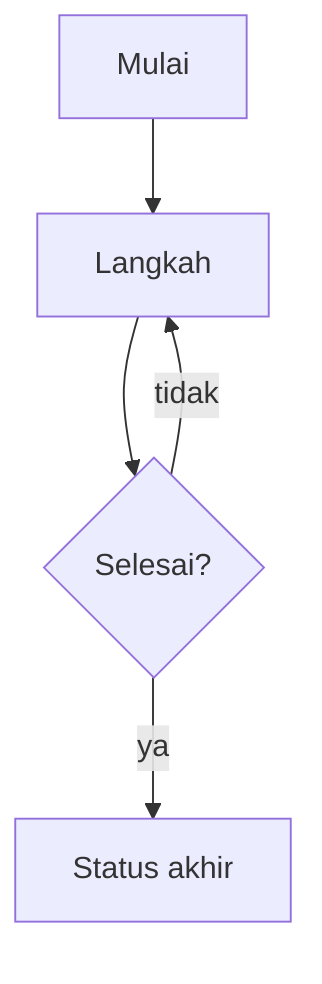

# Template — Catatan Alur

> Salin file ini, ganti judul dan isi, lalu simpan di `04 Alur Bisnis`.

## Frontmatter

```yaml
---
title: Alur <Nama>
type: catatan
area: alur
tags:
  - type/note
  - area/alur
status: aktif
updated: YYYY-MM-DD
source:
  - transaceh-react/src/<path>
---
```

## Ringkas

Satu paragraf: siapa melakukan apa, dan status apa yang berubah.

## Diagram



## Langkah

1. 
2. 
3. 

## Status

| Status | Arti |
| :--- | :--- |
|  |  |

## Kondisi gagal

- 

## Sumber

- `transaceh-react/src/<path>:baris`

## Tautan

- [[00 Alur Bisnis MOC]]
